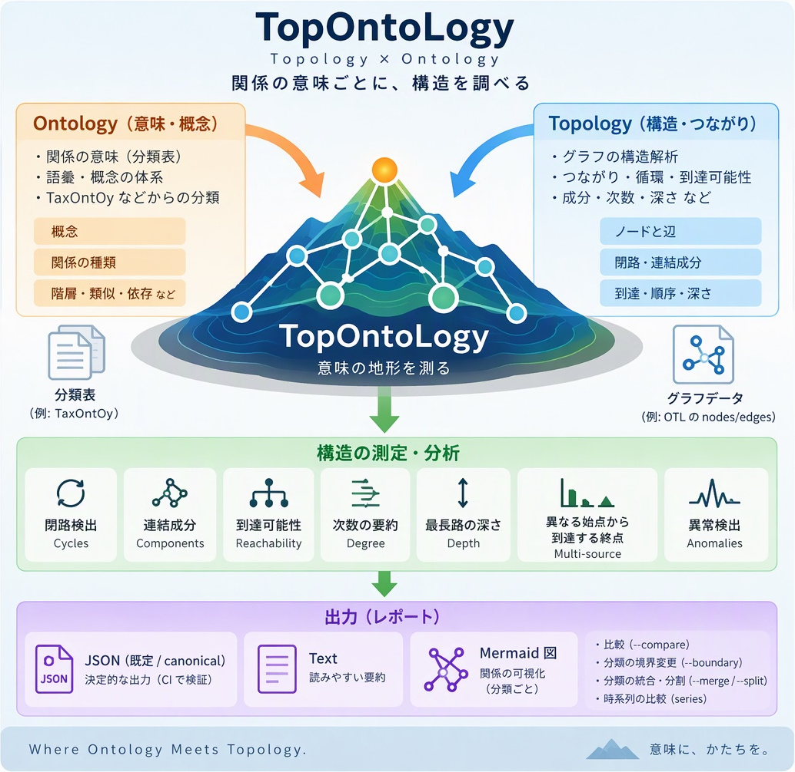

# TopOntoLogy


**TopOntoLogy** は、Topology（トポロジー）と Ontology（オントロジー）を組み合わせた造語。

トポロジーが扱う「構造とつながり」と、オントロジーが扱う「意味と概念の体系」。
その対応関係を探るためのプロジェクトです。

 [ファビコン（32 × 32）](docs/assets/favicon.png)

## 関係の意味ごとに構造を調べる



グラフとプロファイルを引数で渡します。分類表を省くと TaxOntOy の `otl-relations.json` を使います。ONTO はプログラムが `sys.path` の先頭に足すので、`PYTHONPATH` は要りません。Python 3.11 以降の標準ライブラリだけを使います。

ONTO と TaxOntOy の場所は `onto_path.py` だけが知っています。これは ONTO の `onto_path.py` を vendors した複製で、リポジトリごとの値はファイル先頭の定数だけです。解決の順は次です。

1. 明示の `--onto-root` / `--taxontoy-root`
2. 環境変数 `ONTO_ROOT` / `TAXONTOY_ROOT`
3. 推定。TopOntoLogy の隣の `../ONTO` と `../TaxOntOy` を先に見ます。親リポジトリの子や孫として入っているときは、アンカーから上へ辿り、マーカー（`knowledgegraph.py`、`otl-relations.json`）のある checkout を探します

空の明示引数は環境変数へ落としません。マーカーが無いディレクトリは使いません。見つからないときは、設定する環境変数の名前を書いた日本語のエラーで止まります。`knowledgegraph` の出どころが解決した ONTO でなければ、黙って別のコピーは使いません。

```sh
python -S topontology.py audit.json audit
python -S topontology.py audit.json audit --format text
python -S topontology.py before.json concepts --compare after.json
python -S topontology.py audit.json concepts --format mermaid --class hierarchy
python -S topontology.py audit.json ../TaxOntOy/otl-relations.json audit
```

位置引数が 3 つのときは `グラフ 分類表 プロファイル` です。2 つのときは `グラフ プロファイル` で、分類表は既定です。別の表は `--classification` でも渡せます。

導入した環境ではコマンド名は `topontology` です。読み取り専用で、ネットワークへは出ません。書き出すのは標準出力か、`-o` で指定したファイルだけです。

分類ごとに次を返します。

- 辺数、端点に現れるノード数、異なる複数の始点から到達する終点 ID
- 代表的な閉路（既定は最大 5 件、`--cycle-limit` で変更）。検出は ONTO の `relation_cycles`
- 次数の要約（入・出・合計の最大と、始点・終点の数）
- 弱連結成分の個数と大きさ
- 最長の有向路の長さ。ONTO の `topological_order`（`graphlib.TopologicalSorter`）が閉路を見つけた分類では `depth` は null で、`order_cycle` にその閉路を残します
- 独立閉路 `independent_cycles`。辺数を E、端点の数を V、弱連結成分の数を C として E − V + C。有向閉路がなくても、無向にしたときに近道があると 1 以上になります。同梱の hierarchy は A→B、B→C、A→C で、有向閉路はなく深さは 2、独立閉路は 1 です

分類表にない辺の数も返します。類似関係の閉路は相互リンクでも生じます。階層の循環を調べるときは hierarchy 欄を使います。

分類表の `schema` が `taxontoy-relations/1` または `taxontoy-relations/2` のとき、プロファイルは `audit`、`concepts`、`cases` です。`schema`、`direction`、`excluded`、`properties` はどちらの版でもプロファイルではありません。`properties` が関係名からクラス名への対応に見えても、プロファイルとしては読みません。`taxontoy-relations/` の知らない版（`/3` など）は、終了コード 1 で版が未知だと知らせます。`schema` の無い表は、これまでどおり各キーがプロファイルです。`/1` と `/2` の `audit`、`concepts`、`cases` は今までどおり読めます。

## 出力

どの出力にもツール名と版、入力したグラフと分類表のパス、それぞれの sha256 が入ります。比較では左右の両方を記録します。Mermaid では図の先頭コメントです。

JSON はキー順を固定した一つの文書です。`--format canonical` と `--format json` は同じバイト列で、`--json` は `--format json` の省略です。既定は json です。`--format text` は同じ内容の行です。

`--format mermaid --class 分類名` は、その分類の辺だけを ONTO の `graph_mermaid` で描きます。

`--compare 別のグラフ` は、同じ分類表と同じプロファイルで二つのグラフを比べ、差分は右から左を引いた値です。`--class 左 --compare-class 右` は、一つのグラフの二つの分類を比べます。

`--anomalies` は、分類ごとと関係ごとに、ノードの入次数・出次数・合計次数・弱連結成分の大きさ・根からの最長路を集め、平均から 1σ、2σ、3σ を超えるものを帯として返します。ちょうど kσ の点はその帯には入れません。3 点未満、または分散が 0 のときは割らずに `not applicable` です。閉路のある範囲では深さの帯も `not applicable` です。同じ偏差の並びは `(型名, 文字列化した値)` で決めます。

分類の境界を動かすときは、右の分類から左の分類を引きます。`--boundary 別の分類表` はもう一つの表と比べます。`--merge 分類 --merge 分類 --into 新しい分類` は二つの分類を一つにまとめ、`--split 分類 --assign 関係=分類` は指定した関係を別の分類へ移します。`--assign` は繰り返して複数の関係を移せます。どちらの出自にもグラフと分類表のパスと sha256 が入り、まとめ方や分割は `mapping` に残します。

`tests/expected/` は、この決定的な出力を fixture から再生成したものです。CI が同じコマンドを実行し、差分があれば失敗します。

ノード ID は JSON の型のまま集計します。数値の `1` と文字列の `"1"` は別の頂点です。弱連結成分の起点や並びは `(型名, 文字列化した値)` で決め、比較できない型が混ざっても落ちません。`--format text` と Mermaid では表示のために文字列化します。同じ表示になる ID が複数あるとき、Mermaid の枠ラベルでも文字列以外を `型名:値` と書いて区別します（名前が重複しない節は、そのまま出します）。JSON では元の型のまま出します。

辺に `kind` も `relation` もないときは、トレースバックではなく `ValueError` を標準エラーに出して終了コード 1 で終わります。

## 互換

OnTautoLogy の `examples/wave_relations.py` は `from topology import summarize` を使います。その関数だけ残してあります。コマンドとしては `topology.py` は動きません。

## テスト

```sh
uv run --no-project python -S -m unittest discover -s tests -v
```

CI は Python 3.11 と 3.15 でこのコマンドを実行します。続けて、子プロセスの CLI も含めて `topontology.py` と `topology.py` と `onto_path.py` の文と枝を測り、実行 + 除外 + 未実行が全体と一致し、未実行が 0、除外が 0 であることを確認します。ONTO は main の first-parent マージ `8ca1ee5dc8c2714ddcdea6db6774f7168c0e617b`、TaxOntOy は main の first-parent マージ `8621f2261d694af0de35e103ad2387872ca10b99` を checkout します。環境変数を渡さない実行でも、隣の checkout を見つけて同じように動くことを確認します。pytest は依存にしていません。直下の `conftest.py` は pytest で動かすときだけ読み、`ONTO_ROOT` と `TAXONTOY_ROOT` を同じ順で入れて出どころを確かめます。ツールの版は 0.7.0 です。

## 時点の並び

`series` は、同じ分類表でグラフの並びを隣同士で比べます。各時点は `--snapshot ラベル=パス` で、順番どおりに繰り返します。分類表を省くと TaxOntOy の `otl-relations.json` です。`--classification` で別の表を渡せます。ラベルは不透明な文字列です（OnTautoLogy の main のコミット SHA を想定していますが、ネットワークでは取りに行きません）。

```sh
python -S topontology.py series concepts \
  --snapshot aaaaaaaa=before.json --snapshot bbbbbbbb=after.json
```

隣り合う組ごとに、グラフ全体の独立閉路 E−V+C と弱連結成分の差分、分類ごとの差分（既存の比較と同じ右引く左）、その差分を説明する追加辺と削除辺（source、relation、target を並べたもの）を返します。ラベルの重複、または時点が 2 つ未満のときは、トレースバックではなく 1 行のエラーで終了コード 1 です。

同じ出力に、系列全体でのノードの出入りが入ります。ノードは、その時点の辺の端点に現れたときいる。`nodes` の各項目は次です。

- `first_seen` は、最初にいた時点のラベル
- `last_seen` は、最後にいた時点のラベル
- `disappeared` は、最後の時点にいないときの、最後にいた時点の次のラベル。最後までいるときは null。途中で消えて戻ったあとも最後にいるなら null で、途中の離脱は `leaves` に残します
- `enters` は、不在から存在への回数。系列の前は不在とみなすので、最初の出現も 1
- `leaves` は、存在から不在への回数
- `churn` は `enters` と `leaves` の和
- `classes` は、そのノードに触れた辺の関係が属するクラス。分類表に無い関係は入れません。名前順です

`repeated_churn` は churn が 2 以上のノードです。一度現れて最後まで残るノード（churn が 1）は含めません。並びは churn の降順で、同じときはノード ID の `(型名, 文字列化した値)` の昇順です。

`--graph-format vendor-lock` を付けると、時点のパスは `vendor-lock/1` です。`tests/fixtures/aoi-history/` は、公開されている Aoi の `vendor.lock.json` の履歴です。そのパスを変更したコミットは 15 件で、blob も 15 個、すべて違います。グラフが読む `repository`、`source`、`destination` が変わるのはそのうち 7 件です。残りの 8 件は `commit` や `sha256` だけの差で、このツールの辺は変わりません。main `320126983a992e30730350c5e9b0e4051c0d33d4` の blob `644535e13ddbe5639bd6d0f93e2c4ba97d1d208e` は、最後にファイルを変えた `d059324dd9d83a30b20bd4f675105fb2799e7c89` と同じで、グラフは `44a0a39a14e49ea938a3c83c8dbe4b3fba9e4143` から変わっていません。fixture には、その 7 時点についてグラフが読む項目だけを残してあります。出自は `provenance.json` です。フルクローンはしていません。

この 7 時点では、`vendor/markdown.py` は最初から最後まで残り、churn は 1 です。`vendor/web_ui.py` と `vendor/web-ui-LICENSE` は途中で現れ、`014afdc6063b8db17135731b24c624e19d3c410f` で消えます。上流の ID は `b4d91f117729396c9443a7f86f587ec46f6347f7` で `myon-bioinformatics/web-ui` から `myon-bioinformatics/PySaiyanWeBoo` へ替わるので、古い上流ノードはそこで消え、新しい上流ノードはそこで現れ、ファイルを外した時点で消えます。どのノードも enters は 1 で、一度消えたノードが戻った例はありません。churn が 2 の 6 ノードが `repeated_churn` で、ID の順に並びます。

## 除外した関係を戻したときの構造

`excluded` は、分類表の `excluded` に並ぶ関係をクラスへ戻した場合と、除外したままの場合を比べます。差分は `compare_graphs` で、右（除外したまま）から左（戻したとき）を引きます。見るのは弱連結成分、独立閉路、深さ、有向閉路です。

```sh
python -S topontology.py excluded audit.json audit
```

クラスごとの比較は、そのプロファイルの除外関係をすべてそのクラスへ入れたときです。関係ごとの比較は、一つの関係だけを一つのクラスへ入れたときです。除外すると独立閉路が減る、または有向閉路が消えるとき `removed_cycles` です。有向閉路が消えるときは `removed_directed_cycle` も真です。弱連結成分が増えるときは `split_components` で、除外していた関係が成分をつないでいたことを示します。

`exclusion_passes_acyclicity` は、クラスが `properties.classes` で `acyclic` を宣言していて、関係を戻すと有向閉路があり、除外すると無いときだけ真です。`acyclicity_flags` はその関係とクラスの組です。`_`、`-`、空白、途中の大文字を区切りとして畳むと分類済みの関係と同じになる名前は `alias_of` に残します。`depends_on` は `dependsOn` の別名候補です。別名だからといって、その関係だけを戻したときに有向閉路ができるとは限りません。

TaxOntOy のピン `8621f2261d694af0de35e103ad2387872ca10b99` の `otl-relations.json` では、audit の除外が 18（`belongsTo`、`blocks`、`depends_on`、`targets` など）、concepts の除外が 6 です。同じピンの `coverage.json` では、`dependsOn` は 13 辺で非循環、`depends_on` も 13 辺で、向きも含めて同じ端点の組であり、区切りの別名でもあります。`depends_on` だけを dependency へ戻すと辺が 13 本増えて独立閉路も 13 増えますが、有向閉路は増えず、非循環の宣言は戻す前も戻したあとも通ります。`exclusion_passes_acyclicity` は `depends_on` については偽です。`blocks` も 13 辺で、`dependsOn` の逆向きの組です。dependency は `acyclic` を宣言しているので、`blocks` をそのクラスへ戻すと各組が有向の 2 閉路になり、除外したままなら非循環の検査を通ります。フラグが立つのは `blocks` と dependency の組です。`build/audit.json` 自体は公開ツリーに無いので、この帰結は公開された被覆報告と端点集合の定義から出しています。

`--format text` と json で、`--json` は `--format json` の省略、`--format canonical` は json と同じバイト列です。出自にはグラフと分類表のパス、sha256、プロファイル、ツールの版が入ります。`schema` の無い表には除外リストが無く、差分は 0 です。

## vendor-lock/1

`--graph-format vendor-lock` は、`schema` が `vendor-lock/1` の JSON をグラフとして読みます。読む項目は次だけです。

- `schema`。`vendor-lock/1` 以外はエラー
- `files`。配列でないときはエラー
- 各要素の `destination`（空でなければこちら）または `path`。ローカル側のノード ID
- 各要素の `repository` と `source`。上流のノード ID。両方あるときは `repository:source`、`repository` だけならその文字列、`source` だけならその文字列

辺はローカルから上流へ向き、relation は `vendorsFrom` です。`commit`、`ref`、`sha256`、`blob_sha` は読みません。出力のノードと辺は ID で並べます。`tests/fixtures/vendor-lock.json` は合成した例です。

## vendor-lock の影響範囲

`impact` は、複数の `vendor-lock/1` をリポジトリごとに読み、`vendorsFrom` を上流から下流へ辿ります。各ロックは `--lock リポジトリ=パス` です。

ロックを持つリポジトリのコピーは `リポジトリ:destination` です。別のロックが `repository:source` でそのファイルを指すと、ホップがつながります。上流の各 `リポジトリ:ファイル` について、到達する下流リポジトリの数、そこまでの最短ホップ、その先へファイルを渡している子リポジトリ（中継）を返します。数の多い順、同じなら ID の順です。同じ入力は同じバイト列です。

一つのコピーが辿れる根がちょうど一つで、閉路が無いとき、`policy` の `single-canonical-source` は holds です。中継があっても根が一つなら holds のまま、中継は `relays` に出します。根が二つ、または閉路があるコピーは violations です。

到達の距離は `collections.deque`、閉路の有無は `graphlib.TopologicalSorter` です。ONTO の `knowledgegraph.py` には、この逆向きの到達を返す関数はまだありません。

```sh
python -S topontology.py impact \
  --lock myon-bioinformatics/Aoi=vendor.lock.json \
  --lock myon-bioinformatics/QueRyu=queryu/vendor.lock.json
```

出力は `--format text` または json です。`--json` は `--format json` の省略で、`--format canonical` は json と同じバイト列です。出自には各ロックのパスと sha256、ツールの版が入ります。

`tests/fixtures/aoi-locks/` は、Aoi の `320126983a992e30730350c5e9b0e4051c0d33d4` にある vendor.lock.json から、グラフが使う `repository`、`source`、`destination` だけを写したものです。子リポジトリの名前は同じコミットの `child-heads.json` です。出自は `provenance.json` にあります。この写しでは `fleet_check.py` が 6 リポジトリへ届き、いちばん広く届きます。

## 宣言した依存と、実際の import

`deps` は、Aoi の `aoi.py` が持つ `SIBLINGS`（宣言）と、渡したローカルのソースディレクトリにある Python の import（実際）を比べます。ファイルは `ast` で読むだけで、実行しません。パスは引数だけで、ネットワークにも clone にも行きません。

```sh
python -S topontology.py deps \
  --declared aoi.py \
  --import-map import-map.json \
  --source dragowing=./dragowing \
  --source queryu=./queryu
```

宣言の辺は、子の名前から `SIBLINGS` のパス文字列へ向きます。`queryu` と `queryu/core` は別の辺です。`.` はランチャーのルートで、リポジトリ名の既定は `aoi` です。対応表の `root` で変えられます。

import のモジュール名は、次の順でパスへ対応します。

- 相対 import（`.` で始まるもの）は対応させません
- `import-map/1` の `modules`。キーはモジュール名か、そのドット区切りの接頭辞で、いちばん長いものが先です。値は `SIBLINGS` のパスです
- 宣言表のうち、スラッシュが無く `.` でもないパス。`pythdragoras` は `import pythdragoras` に対応します。`pythdragoras/core` や `queryu/ask` のように中のファイル名がパスと違うものは、対応表に書きます

対応しなかった import は `unmapped` に、モジュール名とファイルと行を残します。捨てません。標準ライブラリも、自分のパッケージも、ここに残ります。

走査したリポジトリごとに、パスの集合で三つに分けます。両方にあるものが `matching`、宣言だけで import が無いものが `declared_but_unused`、import だけで宣言が無いものが `used_but_undeclared` です。ソースを渡していない子は `not_scanned` で、未使用とは呼びません。並びはリポジトリ名、パス、ファイル、行で固定です。

出自には、宣言ファイルと対応表と、各ソースディレクトリのパス、読んだ `.py` の相対パスと sha256、ツールの版が入ります。`--format text` と json で、`--json` は `--format json` の省略、`--format canonical` は json と同じバイト列です。

読める代入は、ファイルの直下の `SIBLINGS = {...}` と `SIBLINGS["名前"] = (...)` だけです。`+=`、`|=`、`update`、`append`、`del`、および `if` や関数の中の代入は、実行せず `ValueError` にします。読み取りはそのまま見送ります。

同じ読み取りはグラフの形式でも使えます。`--graph-format aoi-siblings` は Python ファイルの `SIBLINGS` を `declares` の辺にします。`--graph-format py-imports` は `py-imports/1` のマニフェスト（`declared`、任意の `import_map`、`sources`）を読み、パスはそのファイルの場所から相対です。解決したパスがマニフェストのディレクトリの外に出るときはエラーです。ソースディレクトリ内のシンボリックリンクが、そのディレクトリの外のファイルを指すときもエラーで、中身は読みません。辺の relation は `imports` と `unmapped` です。分類表にその relation があれば、いつもの指標で測れます。

`tests/fixtures/siblings/` は、次のコミットからバイトを写したものです。出自は `provenance.json` です。

- Aoi `320126983a992e30730350c5e9b0e4051c0d33d4` の `aoi.py`
- DRAgoWing `4dbfb902e07c83555346497762c77f5c6e656a2b` の `conftest.py` と `tests/test_forms.py`
- QueRyu `2cba00797e0a564489c4dcc98859051cad678519` の `conftest.py`

この範囲では、DRAgoWing は `pythdragoras/core`（`propositions`）と `queryu/ask`（`ask`）が宣言と一致し、`pythdragoras` 自体の import は無く、`aoi` と `aoi_paths` は宣言に無い `.` です。QueRyu は `blueprobe` が一致し、`blueprobe/npb` はこのファイルには無く、`ask` は QueRyu 自身の `queryu/ask` で宣言には入っていません。`blueprobe`・`nagoyaction`・`pythdragoras`・`sakanalytics` はソースを渡していないので `not_scanned` です。

ONTO `8ca1ee5dc8c2714ddcdea6db6774f7168c0e617b` の `knowledgegraph.py` は、閉路とトポロジカル順と Mermaid だけで、辺集合の差は返しません。そのあとの main も文書の更新なので、ピンはこのコミットのままです。差の計算はこのツールの中に置いてあります。
