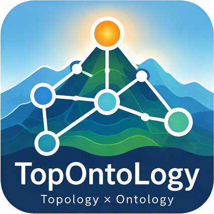

# TopOntoLogy



**TopOntoLogy** は、Topology（トポロジー）と Ontology（オントロジー）を組み合わせた造語。

トポロジーが扱う「構造とつながり」と、オントロジーが扱う「意味と概念の体系」。
その対応関係を探るためのプロジェクトです。

 [ファビコン（32 × 32）](docs/assets/favicon.png)

## 関係の意味ごとに構造を調べる


OTL の nodes/edges JSON と TOO の分類表は引数で渡します。引数を省略したときは環境変数 `TOPONTOLOGY_GRAPH`、`TOPONTOLOGY_CLASSIFICATION`、`TOPONTOLOGY_PROFILE` を使います。引数が優先です。ONTO の `knowledgegraph.py` は `PYTHONPATH` で渡します。プログラムは隣の checkout を探しません。Python 3.11 以降の標準ライブラリだけを使います。

```sh
PYTHONPATH=../ONTO python -S topontology.py audit.json ../TaxOntOy/otl-relations.json audit
PYTHONPATH=../ONTO python -S topontology.py audit.json ../TaxOntOy/otl-relations.json audit --format text
PYTHONPATH=../ONTO python -S topontology.py before.json ../TaxOntOy/otl-relations.json concepts --compare after.json
PYTHONPATH=../ONTO python -S topontology.py audit.json ../TaxOntOy/otl-relations.json concepts --format mermaid --class hierarchy
TOPONTOLOGY_GRAPH=audit.json TOPONTOLOGY_CLASSIFICATION=../TaxOntOy/otl-relations.json TOPONTOLOGY_PROFILE=audit \
  PYTHONPATH=../ONTO python -S topontology.py --format text
```

導入した環境ではコマンド名は `topontology` です。読み取り専用で、ネットワークへは出ません。書き出すのは標準出力か、`-o` で指定したファイルだけです。

分類ごとに次を返します。

- 辺数、端点に現れるノード数、異なる複数の始点から到達する終点 ID
- 代表的な閉路（既定は最大 5 件、`--cycle-limit` で変更）。検出は ONTO の `relation_cycles`
- 次数の要約（入・出・合計の最大と、始点・終点の数）
- 弱連結成分の個数と大きさ
- 最長の有向路の長さ。ONTO の `topological_order`（`graphlib.TopologicalSorter`）が閉路を見つけた分類では `depth` は null で、`order_cycle` にその閉路を残します
- 独立閉路 `independent_cycles`。辺数を E、端点の数を V、弱連結成分の数を C として E − V + C。有向閉路がなくても、無向にしたときに近道があると 1 以上になります。同梱の hierarchy は A→B、B→C、A→C で、有向閉路はなく深さは 2、独立閉路は 1 です

分類表にない辺の数も返します。類似関係の閉路は相互リンクでも生じます。階層の循環を調べるときは hierarchy 欄を使います。

分類表の `schema` が `taxontoy-relations/1` または `taxontoy-relations/2` のとき、プロファイルは `audit`、`concepts`、`cases` です。`schema`、`direction`、`excluded`、`properties` はどちらの版でもプロファイルではありません。`properties` が関係名からクラス名への対応に見えても、プロファイルとしては読みません。`taxontoy-relations/` の知らない版（`/3` など）は、終了コード 1 で版が未知だと知らせます。`schema` の無い表は、これまでどおり各キーがプロファイルです。`/1` と `/2` の `audit`、`concepts`、`cases` は今までどおり読めます。

## 出力

どの出力にもツール名と版、入力したグラフと分類表のパス、それぞれの sha256 が入ります。比較では左右の両方を記録します。Mermaid では図の先頭コメントです。

JSON はキー順を固定した一つの文書です。`--format canonical` と `--format json` は同じバイト列で、`--json` は `--format json` の省略です。既定は json です。`--format text` は同じ内容の行です。

`--format mermaid --class 分類名` は、その分類の辺だけを ONTO の `graph_mermaid` で描きます。

`--compare 別のグラフ` は、同じ分類表と同じプロファイルで二つのグラフを比べ、差分は右から左を引いた値です。`--class 左 --compare-class 右` は、一つのグラフの二つの分類を比べます。

`--anomalies` は、分類ごとと関係ごとに、ノードの入次数・出次数・合計次数・弱連結成分の大きさ・根からの最長路を集め、平均から 1σ、2σ、3σ を超えるものを帯として返します。ちょうど kσ の点はその帯には入れません。3 点未満、または分散が 0 のときは割らずに `not applicable` です。閉路のある範囲では深さの帯も `not applicable` です。同じ偏差の並びは `(型名, 文字列化した値)` で決めます。

分類の境界を動かすときは、右の分類から左の分類を引きます。`--boundary 別の分類表` はもう一つの表と比べます。パスを省くと `TOPONTOLOGY_BOUNDARY` を使い、空白だけなら未設定です。`--merge 分類 --merge 分類 --into 新しい分類` は二つの分類を一つにまとめ、`--split 分類 --assign 関係=分類` は指定した関係を別の分類へ移します。`--assign` は繰り返して複数の関係を移せます。どちらの出自にもグラフと分類表のパスと sha256 が入り、まとめ方や分割は `mapping` に残します。

`tests/expected/` は、この決定的な出力を fixture から再生成したものです。CI が同じコマンドを実行し、差分があれば失敗します。

ノード ID は JSON の型のまま集計します。数値の `1` と文字列の `"1"` は別の頂点です。弱連結成分の起点や並びは `(型名, 文字列化した値)` で決め、比較できない型が混ざっても落ちません。`--format text` と Mermaid では表示のために文字列化します。同じ表示になる ID が複数あるとき、Mermaid の枠ラベルでも文字列以外を `型名:値` と書いて区別します（名前が重複しない節は、そのまま出します）。JSON では元の型のまま出します。

辺に `kind` も `relation` もないときは、トレースバックではなく `ValueError` を標準エラーに出して終了コード 1 で終わります。

## 互換

OnTautoLogy の `examples/wave_relations.py` は `from topology import summarize` を使います。その関数だけ残してあります。コマンドとしては `topology.py` は動きません。

## テスト

```sh
PYTHONPATH=../ONTO uv run --no-project python -S -m unittest discover -s tests -v
```

CI は Python 3.11 と 3.15 でこのコマンドを実行します。続けて、子プロセスの CLI も含めて `topontology.py` と `topology.py` の文と枝を測り、実行 + 除外 + 未実行が全体と一致し、未実行が 0 であることを確認します。ONTO は main の first-parent マージ `8ca1ee5dc8c2714ddcdea6db6774f7168c0e617b`、TaxOntOy は main の first-parent マージ `8621f2261d694af0de35e103ad2387872ca10b99` を checkout し、`PYTHONPATH` で ONTO を渡します。ツールの版は 0.5.0 です。

## 時点の並び

`series` は、同じ分類表でグラフの並びを隣同士で比べます。各時点は `--snapshot ラベル=パス` で、順番どおりに繰り返します。引数があるときはそれが優先です。無いときは環境変数 `TOPONTOLOGY_SNAPSHOTS` を、改行またはカンマで区切った `ラベル=パス` として読みます。前後の空白は除き、空なら未設定です。ラベルは不透明な文字列です（OnTautoLogy の main のコミット SHA を想定していますが、ネットワークでは取りに行きません）。

```sh
PYTHONPATH=../ONTO python -S topontology.py series ../TaxOntOy/otl-relations.json concepts \
  --snapshot aaaaaaaa=before.json --snapshot bbbbbbbb=after.json
```

隣り合う組ごとに、グラフ全体の独立閉路 E−V+C と弱連結成分の差分、分類ごとの差分（既存の比較と同じ右引く左）、その差分を説明する追加辺と削除辺（source、relation、target を並べたもの）を返します。ラベルの重複、または時点が 2 つ未満のときは、トレースバックではなく 1 行のエラーで終了コード 1 です。

## vendor-lock/1

`--graph-format vendor-lock` は、`schema` が `vendor-lock/1` の JSON をグラフとして読みます。読む項目は次だけです。

- `schema`。`vendor-lock/1` 以外はエラー
- `files`。配列でないときはエラー
- 各要素の `destination`（空でなければこちら）または `path`。ローカル側のノード ID
- 各要素の `repository` と `source`。上流のノード ID。両方あるときは `repository:source`、`repository` だけならその文字列、`source` だけならその文字列

辺はローカルから上流へ向き、relation は `vendorsFrom` です。`commit`、`ref`、`sha256`、`blob_sha` は読みません。出力のノードと辺は ID で並べます。`tests/fixtures/vendor-lock.json` は合成した例です。

## vendor-lock の影響範囲

`impact` は、複数の `vendor-lock/1` をリポジトリごとに読み、`vendorsFrom` を上流から下流へ辿ります。各ロックは `--lock リポジトリ=パス` です。引数が無いときは環境変数 `TOPONTOLOGY_LOCKS` を、改行またはカンマで区切った `リポジトリ=パス` として読みます。前後の空白は除き、空なら未設定です。引数があるときは環境変数を使いません。

ロックを持つリポジトリのコピーは `リポジトリ:destination` です。別のロックが `repository:source` でそのファイルを指すと、ホップがつながります。上流の各 `リポジトリ:ファイル` について、到達する下流リポジトリの数、そこまでの最短ホップ、その先へファイルを渡している子リポジトリ（中継）を返します。数の多い順、同じなら ID の順です。同じ入力は同じバイト列です。

一つのコピーが辿れる根がちょうど一つで、閉路が無いとき、`policy` の `single-canonical-source` は holds です。中継があっても根が一つなら holds のまま、中継は `relays` に出します。根が二つ、または閉路があるコピーは violations です。

到達の距離は `collections.deque`、閉路の有無は `graphlib.TopologicalSorter` です。ONTO の `knowledgegraph.py` には、この逆向きの到達を返す関数はまだありません。

```sh
PYTHONPATH=../ONTO python -S topontology.py impact \
  --lock myon-bioinformatics/Aoi=vendor.lock.json \
  --lock myon-bioinformatics/QueRyu=queryu/vendor.lock.json
```

出力は `--format text` または json です。`--json` は `--format json` の省略で、`--format canonical` は json と同じバイト列です。出自には各ロックのパスと sha256、ツールの版が入ります。

`tests/fixtures/aoi-locks/` は、Aoi の `320126983a992e30730350c5e9b0e4051c0d33d4` にある vendor.lock.json から、グラフが使う `repository`、`source`、`destination` だけを写したものです。子リポジトリの名前は同じコミットの `child-heads.json` です。出自は `provenance.json` にあります。この写しでは `fleet_check.py` が 6 リポジトリへ届き、いちばん広く届きます。

## 宣言した依存と、実際の import

`deps` は、Aoi の `aoi.py` が持つ `SIBLINGS`（宣言）と、渡したローカルのソースディレクトリにある Python の import（実際）を比べます。ファイルは `ast` で読むだけで、実行しません。パスは引数か環境変数だけで、ネットワークにも clone にも行きません。

```sh
PYTHONPATH=../ONTO python -S topontology.py deps \
  --declared aoi.py \
  --import-map import-map.json \
  --source dragowing=./dragowing \
  --source queryu=./queryu
```

`--declared` を省くと `TOPONTOLOGY_DECLARED`、`--import-map` を省くと `TOPONTOLOGY_IMPORT_MAP`、`--source` が無いときは `TOPONTOLOGY_SOURCES` を、改行またはカンマで区切った `リポジトリ=パス` として読みます。前後の空白は除き、空なら未設定です。引数があるときは、その項目の環境変数を使いません。

宣言の辺は、子の名前から `SIBLINGS` のパス文字列へ向きます。`queryu` と `queryu/core` は別の辺です。`.` はランチャーのルートで、リポジトリ名の既定は `aoi` です。対応表の `root` で変えられます。

import のモジュール名は、次の順でパスへ対応します。

- 相対 import（`.` で始まるもの）は対応させません
- `import-map/1` の `modules`。キーはモジュール名か、そのドット区切りの接頭辞で、いちばん長いものが先です。値は `SIBLINGS` のパスです
- 宣言表のうち、スラッシュが無く `.` でもないパス。`pythdragoras` は `import pythdragoras` に対応します。`pythdragoras/core` や `queryu/ask` のように中のファイル名がパスと違うものは、対応表に書きます

対応しなかった import は `unmapped` に、モジュール名とファイルと行を残します。捨てません。標準ライブラリも、自分のパッケージも、ここに残ります。

走査したリポジトリごとに、パスの集合で三つに分けます。両方にあるものが `matching`、宣言だけで import が無いものが `declared_but_unused`、import だけで宣言が無いものが `used_but_undeclared` です。ソースを渡していない子は `not_scanned` で、未使用とは呼びません。並びはリポジトリ名、パス、ファイル、行で固定です。

出自には、宣言ファイルと対応表と、各ソースディレクトリのパス、読んだ `.py` の相対パスと sha256、ツールの版が入ります。`--format text` と json で、`--json` は `--format json` の省略、`--format canonical` は json と同じバイト列です。

読める代入は、ファイルの直下の `SIBLINGS = {...}` と `SIBLINGS["名前"] = (...)` だけです。`+=`、`|=`、`update`、`append`、`del`、および `if` や関数の中の代入は、実行せず `ValueError` にします。読み取りはそのまま見送ります。

同じ読み取りはグラフの形式でも使えます。`--graph-format aoi-siblings` は Python ファイルの `SIBLINGS` を `declares` の辺にします。`--graph-format py-imports` は `py-imports/1` のマニフェスト（`declared`、任意の `import_map`、`sources`）を読み、パスはそのファイルの場所から相対です。解決したパスがマニフェストのディレクトリの外に出るときはエラーです。ソースディレクトリ内のシンボリックリンクが、そのディレクトリの外のファイルを指すときもエラーで、中身は読みません。辺の relation は `imports` と `unmapped` です。分類表にその relation があれば、いつもの指標で測れます。

`tests/fixtures/siblings/` は、次のコミットからバイトを写したものです。出自は `provenance.json` です。

- Aoi `320126983a992e30730350c5e9b0e4051c0d33d4` の `aoi.py`
- DRAgoWing `4dbfb902e07c83555346497762c77f5c6e656a2b` の `conftest.py` と `tests/test_forms.py`
- QueRyu `2cba00797e0a564489c4dcc98859051cad678519` の `conftest.py`

この範囲では、DRAgoWing は `pythdragoras/core`（`propositions`）と `queryu/ask`（`ask`）が宣言と一致し、`pythdragoras` 自体の import は無く、`aoi` と `aoi_paths` は宣言に無い `.` です。QueRyu は `blueprobe` が一致し、`blueprobe/npb` はこのファイルには無く、`ask` は QueRyu 自身の `queryu/ask` で宣言には入っていません。`blueprobe`・`nagoyaction`・`pythdragoras`・`sakanalytics` はソースを渡していないので `not_scanned` です。

ONTO `8ca1ee5dc8c2714ddcdea6db6774f7168c0e617b` の `knowledgegraph.py` は、閉路とトポロジカル順と Mermaid だけで、辺集合の差は返しません。そのあとの main も文書の更新なので、ピンはこのコミットのままです。差の計算はこのツールの中に置いてあります。
